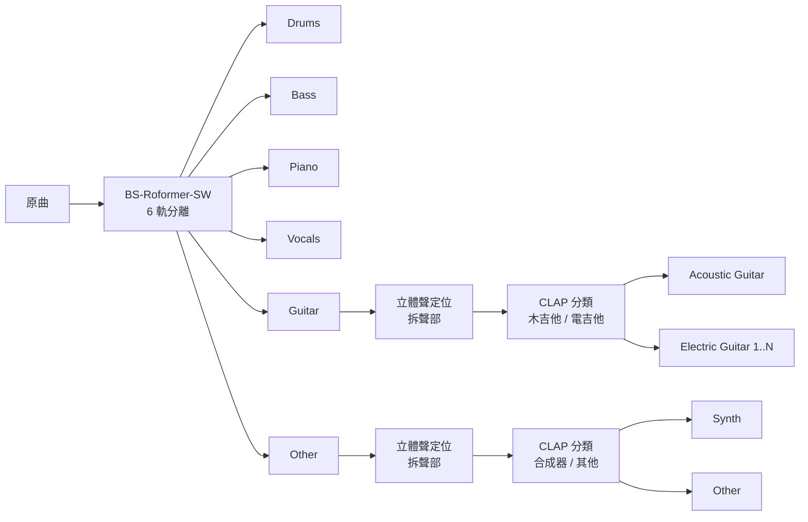

# StemSplitter 音檔樂器分軌工具

把一首歌拆成各樂器的獨立音軌：爵士鼓、Bass、電吉他、木吉他、鋼琴、合成器、人聲與其他。
**多把電吉他會依左右定位拆成不同檔案**，不會全部擠在同一軌。

全部在本機執行，音檔不會上傳到任何地方。

## 輸出範例

```
歌曲 - Stems/
├── 歌曲 - Drums.wav
├── 歌曲 - Bass.wav
├── 歌曲 - Electric Guitar 1 (Left).wav
├── 歌曲 - Electric Guitar 2 (Right).wav
├── 歌曲 - Acoustic Guitar.wav
├── 歌曲 - Piano.wav
├── 歌曲 - Synth.wav
├── 歌曲 - Vocals.wav
└── 歌曲 - Other.wav
```

歌曲裡沒有的樂器不會產生檔案。執行時也會列出每種樂器偵測到「有」或「無」與音量，並推測 Other 軌裡可能有什麼（弦樂、銅管、風琴…）。

| 檔名 | 樂器 |
|---|---|
| Drums | 爵士鼓 |
| Bass | 貝斯 |
| Electric Guitar / Electric Guitar N (位置) | 電吉他；有多把時依定位編號，位置為 Left / Center-Left / Center / Center-Right / Right |
| Acoustic Guitar | 木吉他 |
| Piano | 鋼琴 |
| Synth | 合成器 |
| Vocals | 人聲 |
| Other | 其他無法歸類的樂器 |

## 安裝

需求：Windows 或 macOS (Linux 也可)，[Python 3.10 以上](https://www.python.org/)。

| 平台 | 加速方式 | 速度 |
|---|---|---|
| Windows / Linux + NVIDIA 顯示卡 (建議 8 GB VRAM 以上) | CUDA | 最快 |
| macOS Apple Silicon (M1 以上) | MPS | 中等 |
| 其他 (無 NVIDIA 顯示卡、Intel Mac) | CPU | 很慢 |

```bash
git clone <this repo>
cd StemSplitter
python install.py
```

macOS 若 `python` 指令不存在，請改用 `python3`。

`install.py` 會在專案裡建立 `.venv`，依平台與顯示卡安裝對應版本的 PyTorch 與其他套件。沒有 NVIDIA 顯示卡、卻被誤判時，可加 `--cpu` 強制安裝 CPU 版。

第一次分軌時會自動下載模型 (約 1–2 GB)，存在專案的 `.cache/` 資料夾。系統沒有 ffmpeg 時也會自動下載一份。

> 想把模型與快取放到其他磁碟，可設定環境變數 `STEMSPLIT_DATA`
> (Windows: `set STEMSPLIT_DATA=D:\stemsplit`，macOS: `export STEMSPLIT_DATA=~/stemsplit`)。

## 使用方式

```bash
python split_stems.py "歌曲.mp3"
python split_stems.py "歌1.mp3" "歌2.wav"            # 一次處理多首
python split_stems.py "歌曲.mp3" -o "分軌結果"        # 指定輸出資料夾
python split_stems.py "歌曲.mp3" --guitars electric  # 所有吉他都當電吉他
python split_stems.py "歌曲.mp3" --model demucs      # 較快但品質較差的模型
```

不需要先 activate `.venv`：用任何 Python 執行 `split_stems.py`，它都會自動切換到專案的 `.venv`。

| 參數 | 說明 |
|---|---|
| `-o, --output` | 輸出資料夾，預設為原檔所在資料夾 |
| `--model roformer\|demucs` | 主分軌模型，預設 `roformer` (BS-Roformer-SW，品質較好)；`demucs` (htdemucs_6s) 較快 |
| `--guitars auto\|electric\|acoustic` | 吉他類型，預設 `auto` 自動判斷；自動判斷錯誤時可強制指定 |

支援 ffmpeg 能讀的格式 (mp3、wav、flac、m4a…)。輸出一律為 44.1 kHz / 24-bit 立體聲 WAV。
在 RTX 4060 Ti 上，24 秒的測試片段約 25 秒 (含載入模型)，完整歌曲會依長度增加。

## 原理



處理分四個階段：

### 1. 主分軌：深度學習音源分離

先用 [audio-separator](https://github.com/nomadkaraoke/python-audio-separator) 載入 **BS-Roformer-SW** 模型 (或 Meta 的 **Demucs htdemucs_6s**)，把混音拆成 6 軌：鼓、Bass、吉他、鋼琴、人聲、其他。

這類模型以大量「混音 + 各樂器原始分軌」訓練，學會在頻譜上辨認每種樂器的特徵，並為每個時頻點估計屬於哪種樂器 (遮罩)。BS-Roformer 先把頻譜切成多個頻帶 (Band-Split)，再用 Transformer 同時建模時間與頻率上的關係，是目前分離品質最好的架構之一。

這些模型只分到「吉他」與「其他」這一層，不會區分木吉他、電吉他、合成器，也不會區分同一軌裡的多把吉他。所以接下來用另外兩個方法再細分。

### 2. 多把吉他：立體聲定位 (Panning) 分離

混音時，多把吉他通常會擺在不同的左右位置。最常見的是兩把節奏吉他一左一右 (double tracking)，主奏吉他放中間。本工具利用這點來拆分 (`pan_split.py`)：

1. 對左、右聲道做短時傅立葉轉換 (STFT)，得到每個時間 × 頻率點的強度。
2. 計算每個點的**定位指數** `pan = (|R| − |L|) / (|R| + |L|)`，範圍 −1 (最左) 到 +1 (最右)。
3. 只取較大聲的時頻點，以能量為權重畫出定位直方圖。每個明顯的峰值，就是一個擺在該位置的聲部 (一把吉他)。
4. 對每個峰值建立高斯形狀的**軟遮罩**，在 log 域正規化，讓每個時頻點的遮罩總和為 1，把能量分配給最接近的聲部。最後做逆 STFT 轉回音訊。

因為遮罩總和為 1，所有聲部加起來會等於原本的吉他軌，聲音不會遺失。太小聲的聲部會併入定位最接近的聲部。

### 3. 樂器辨識：CLAP 零樣本分類

木吉他/電吉他、合成器/其他樂器沒有現成的分離模型，所以改用**分類 + 依時間分配**的方式 (`clap_route.py`)：

1. 把每個聲部切成 4 秒的片段。
2. 用 LAION 的 [CLAP](https://huggingface.co/laion/clap-htsat-unfused) 模型 (Contrastive Language-Audio Pretraining) 把每段音訊和一組文字描述 (例如 *"the sound of distorted electric guitar"*、*"the sound of acoustic guitar"*) 轉成同一個向量空間的向量，用相似度判斷每段最像哪一類。CLAP 以大量「音訊 + 文字說明」配對訓練，不需要針對吉他另外訓練，因此稱為「零樣本」分類。
3. 每一類用多個描述，以平均機率比較，避免描述較多的類別佔便宜。
4. 太小聲的片段判斷不可靠，沿用鄰近片段的結果；再用中位數濾波去掉零星誤判。
5. 依判斷結果把每段分配到對應的軌，片段交界處做 0.25 秒淡入淡出，避免爆音。

### 4. 樂器偵測

每一軌輸出前會檢查：

- 整體音量相對原曲高於 −40 dB
- 至少 3% 的時間有明顯聲音

兩者都成立才視為「有這個樂器」並輸出檔案，避免產生只有雜訊或殘響的空軌。

## 限制

- **擺在同一位置的多把吉他無法拆開**：定位分離只看左右位置。兩把吉他都放中間時會被視為同一把，輸出成單一「Electric Guitar」。
- **木吉他/電吉他、合成器是以 4 秒為單位判斷**：同一時間、同一位置同時有木吉他與電吉他時，無法再細分。若自動判斷錯誤，可用 `--guitars electric` 或 `--guitars acoustic` 強制指定。
- **合成器的範圍很廣**：仿真弦樂、鋼琴音色的合成器可能被歸到 Other 或 Piano。
- **分離不會完美**：深度學習分離仍會有少量其他樂器的殘音 (bleed)，失真吉他與合成器音色接近時尤其明顯。

## 專案結構

| 檔案 | 說明 |
|---|---|
| `split_stems.py` | 主程式：串接整個流程、偵測樂器、輸出檔案 |
| `pan_split.py` | 立體聲定位分析與軟遮罩分離 |
| `clap_route.py` | CLAP 零樣本分類，依時間把聲音分配到不同軌 |
| `install.py` | 安裝腳本 (Windows / macOS / Linux) |

## 致謝

- [python-audio-separator](https://github.com/nomadkaraoke/python-audio-separator)：分軌模型的執行框架
- BS-Roformer-SW (by jarredou)、[Demucs](https://github.com/facebookresearch/demucs) (Meta)：主分軌模型
- [CLAP](https://github.com/LAION-AI/CLAP) (LAION)：零樣本音訊分類

模型會在第一次執行時從原作者處下載，不包含在本專案中。各模型的授權請參考其原始專案。

請只對你有權使用的音檔進行分軌。
